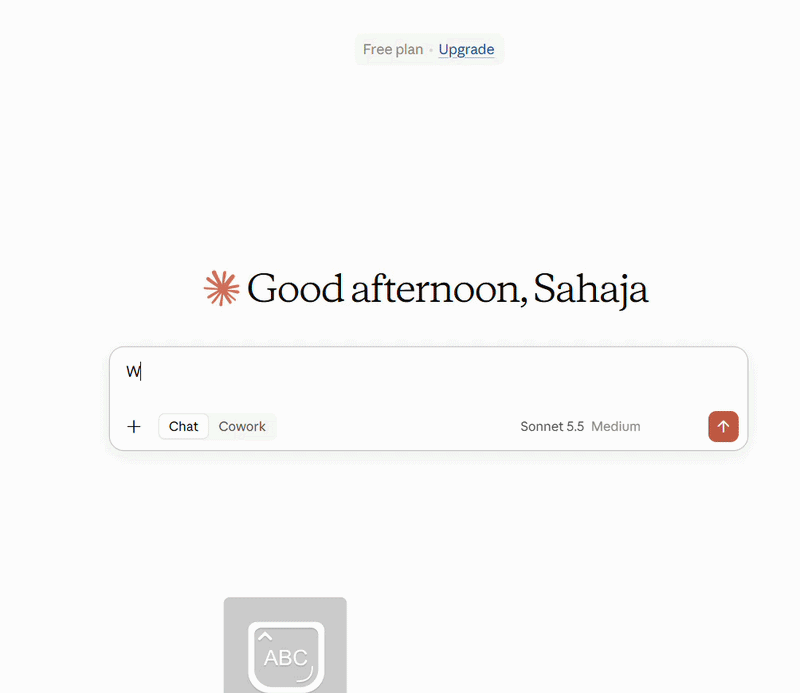
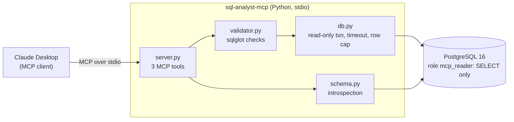

# SQL Analyst MCP Server

[](https://github.com/Sahaja0104/sql-analyst-mcp/actions/workflows/ci.yml)


An [MCP](https://modelcontextprotocol.io) server that lets an LLM answer plain-English questions about a PostgreSQL database **safely**: validated SQL, read-only access, a query timeout and a row cap. Scored 30/30 on a 30-question benchmark and covered by 102 automated tests.

<!-- DEMO: after recording, save the GIF as docs/demo.gif and replace this comment with:  -->


> **You:** Who are the top 3 customers by total spending?
> **Claude:** *(calls `get_schema`, then `run_query`)* Helena Holý (49.62), Richard Cunningham (47.62) and Luis Rojas (46.62).

## Tools

| Tool | What it does |
|---|---|
| `get_schema` | Tables, columns, types, keys and sample rows, so the model knows what exists. |
| `run_query` | Validates and runs **one** SELECT. Returns columns, rows, a `truncated` flag and timing. |
| `explain_query` | Shows PostgreSQL's plan for a query **without running it** (plain `EXPLAIN`, never `ANALYZE`). |

Errors come back as readable messages (for example `Only SELECT queries are allowed (this looks like DROP)`), so the model can fix its query and retry.

## Architecture



## Safety: six layers

If one layer were bypassed, the next would still stop a write.

| # | Layer | What it stops |
|---|---|---|
| 1 | **SQL validator** ([sqlglot](https://github.com/tobymao/sqlglot)) | Anything but one SELECT: writes hidden in a CTE, `SELECT INTO`, `FOR UPDATE`, system tables, dangerous functions (`pg_sleep`, `pg_read_file`, ...). |
| 2 | **Read-only database role** | `mcp_reader` has SELECT permission only. Postgres refuses any write even if read-only mode is switched off. The real lock. |
| 3 | **Read-only transaction** | Every query runs in `BEGIN READ ONLY` and is rolled back. |
| 4 | **Server-side cursor** | It can only wrap read queries. |
| 5 | **Statement timeout** | Postgres cancels queries running longer than 5 seconds. |
| 6 | **Row cap** | At most 100 rows are fetched, streamed so big tables are never loaded into memory. |

## Evaluation

30 English questions about the Chinook sample database, each with a hand-written gold query ([`evals/questions.json`](evals/questions.json)). A generated query is correct when it returns the **same data** as the gold query. Model: Claude Sonnet 5.5 in Claude Desktop, using this server's tools.

| Difficulty | Correct |
|---|---|
| Easy | 10/10 |
| Medium | 11/11 |
| Hard | 9/9 |
| **Overall** | **30/30** |

Per-question results: [`evals/results.md`](evals/results.md). Caveats: Chinook is a small, clean schema, the model could test its queries before answering, and 30 questions is a small sample.

## Quick start

You need [Docker Desktop](https://www.docker.com/products/docker-desktop/) and Python 3.11+.

```bash
docker compose up -d                      # PostgreSQL with data and the read-only role (port 5433)
python -m venv .venv
.venv\Scripts\activate                    # macOS / Linux: source .venv/bin/activate
python -m pip install -e ".[dev]"
python -m pytest -q                       # 102 tests should pass
```

The default settings already match `docker-compose.yml` (copy `.env.example` to `.env` to change them). The passwords are for local development only.

**Connect to Claude Desktop:** Settings, Developer, Edit Config, then add (use the full path to the Python inside your `.venv`; on macOS/Linux it is `.venv/bin/python`):

```json
{
  "mcpServers": {
    "sql-analyst": {
      "command": "C:\\path\\to\\sql-analyst-mcp\\.venv\\Scripts\\python.exe",
      "args": ["-m", "sql_analyst.server"]
    }
  }
}
```

Restart Claude Desktop and ask: *"Which 5 genres have the most tracks?"*

<details>
<summary><b>Project structure</b></summary>

```
sql-analyst-mcp/
├── docker-compose.yml          # PostgreSQL 16, loads db/init/* on first start
├── db/init/
│   ├── 01_chinook.sql          # sample database (music store)
│   └── 02_roles.sql            # read-only mcp_reader role
├── src/sql_analyst/
│   ├── server.py               # MCP server and the 3 tools
│   ├── validator.py            # SQL guardrails
│   ├── db.py                   # safe execution
│   ├── schema.py               # schema introspection
│   └── config.py               # settings from environment / .env
├── tests/
│   ├── test_validator.py       # 76 unit tests, no database needed
│   └── test_db.py              # 26 integration tests against real PostgreSQL
├── evals/
│   ├── questions.json          # 30 questions with gold SQL
│   └── run_eval.py             # builds prompts, grades answers
└── .github/workflows/ci.yml    # all tests on Python 3.11, 3.12, 3.14
```

</details>

<details>
<summary><b>Design decisions</b></summary>

- **Validate the SQL structure, not the text.** Keyword matching is easy to fool (`SELECT 'DELETE FROM x'` is harmless, `WITH d AS (DELETE ...) SELECT ...` is not). Parsing to a syntax tree handles both.
- **The database enforces the rules too.** A validator bug cannot become a data change, because the role cannot write.
- **Server-side cursor instead of rewriting queries.** It fetches only the first 101 rows and tells us if there were more, without changing the user's SQL.
- **Plain `EXPLAIN` only.** `EXPLAIN ANALYZE` executes the query, which defeats a safe preview.
- **Errors are written for the model.** Failures raise the SDK's `ToolError`, which the model can read. Other exceptions are hidden from it.
- **Sample rows are optional.** They help the model see real values but can expose personal data, so `include_samples=false` turns them off.

</details>

<details>
<summary><b>Run the evaluation yourself</b> (no API key needed)</summary>

```bash
python evals/run_eval.py prompt --difficulty easy     # also: medium, hard
# paste evals/prompt_easy.txt into a NEW Claude Desktop chat, save its JSON reply as evals/answers_easy.json
python evals/run_eval.py grade evals/answers_easy.json evals/answers_medium.json evals/answers_hard.json --model "Claude Sonnet 5.5"
```

</details>

<details>
<summary><b>Limitations and next steps</b></summary>

- One database, `public` schema only, local stdio, no authentication.
- Next: a harder benchmark with ambiguous questions, rejecting expensive queries using the `EXPLAIN` cost estimate, and a remote (Streamable HTTP) deployment with authentication and rate limiting.

</details>

---

Built with Python, the official [MCP Python SDK](https://github.com/modelcontextprotocol/python-sdk) (v2), PostgreSQL 16, psycopg 3, sqlglot, pytest, Docker and GitHub Actions.